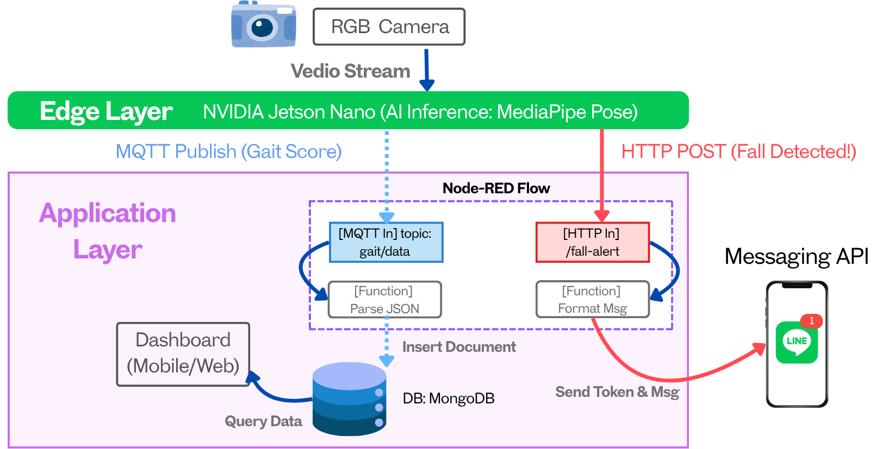
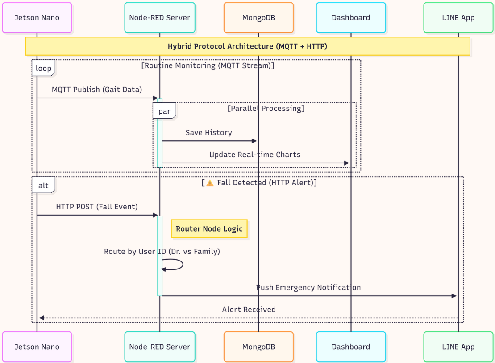
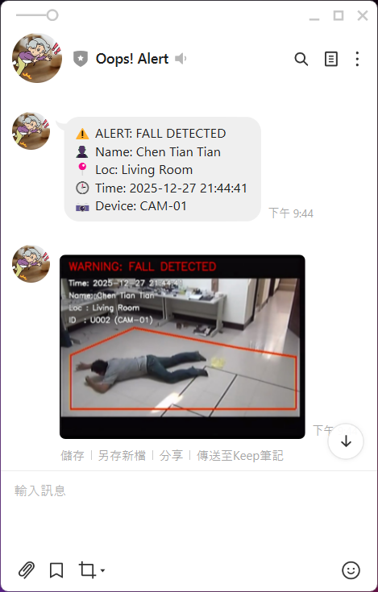
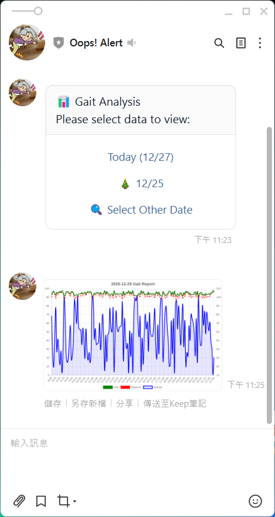
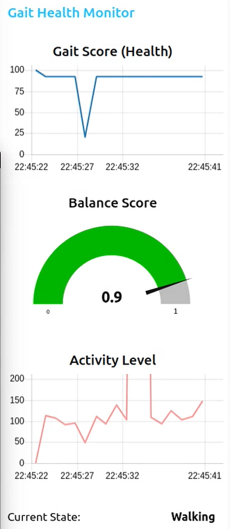
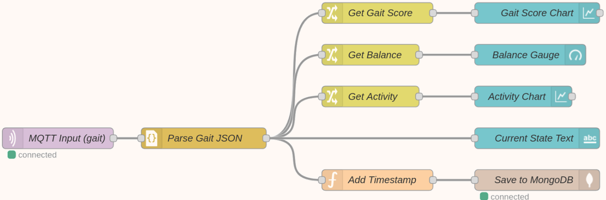
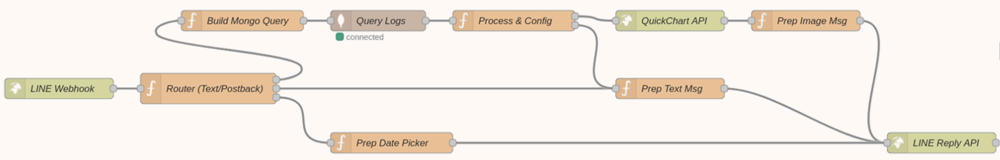
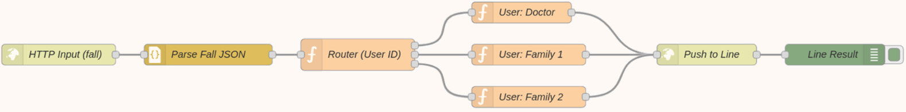

# Smart Gait Analysis & Fall Warning System (Gait AI)

[](https://opensource.org/licenses/MIT)
[](https://www.python.org/)
[](https://nodered.org/)
[](https://developers.google.com/mediapipe)

An AIoT-driven, non-contact elderly monitoring system deployed on edge devices (NVIDIA Jetson Nano / PC). It performs continuous gait stability assessment, body balance analysis, and immediate fall alert notifications via MQTT, Node-RED, and the LINE Messaging API.

---

## Table of Contents

- [System Architecture](#system-architecture)
- [Key Features](#key-features)
- [Demo & Results](#demo--results)
- [Project Structure](#project-structure)
- [Prerequisites](#prerequisites)
- [Installation & Setup](#installation--setup)
- [Environment Variables](#environment-variables)
- [Node-RED & Database Setup](#node-red--database-setup)
- [Running the System](#running-the-system)
- [License](#license)

---

## System Architecture

The system adopts a hybrid edge-cloud architecture:

- **Edge Layer**: Uses OpenCV and MediaPipe Pose to track human body landmarks, estimate sway index and balance scores, and identify fall events.
- **MQTT Pipeline**: Transmits real-time gait metrics (`gait_score`, `balance`, `activity`, `sway`) every second to the broker.
- **HTTP Alert Pipeline**: Upon detecting a fall, captures the frame, writes visual overlays, uploads the snapshot to a temporary image host (ImgBB), and triggers an HTTP POST request to Node-RED.
- **Application Layer**: Node-RED processes alerts, logs telemetry into MongoDB, visualizes real-time metrics on a dashboard, and dispatches rich push notifications to LINE users.



### Sequence Diagram



---

## Key Features

- **Non-Contact Vision Monitoring**: Tracks postural changes using standard RGB camera feeds, avoiding the discomfort and compliance issues of wearable devices.
- **Continuous Gait Assessment**: Computes Center-of-Gravity (CoG) sway index, balance scores, and activity levels.
- **Asynchronous Fall Alert Dispatcher**: Captures fall event frames in a non-blocking worker thread, uploads them with an expiration TTL, and dispatches alerts without freezing video processing.
- **Role-Based Notification Router**: Dispatches alerts to caregivers, family members, or doctors according to monitored subject IDs.
- **Interactive LINE Bot Integration**: Enables family members and medical staff to query historical gait trends and daily reports directly through LINE chat.

---

## Demo & Results

### Monitoring & Notification Overview

<table width="800">
  <tr>
    <td align="center" valign="bottom">
      <br>
      <b>Fall Alert (LINE Push)</b>
    </td>
    <td align="center" valign="bottom">
      <br>
      <b>Gait Analysis (LINE Reply)</b>
    </td>
    <td align="center" valign="bottom">
      <br>
      <b>Dashboard (Node-RED)</b>
    </td>
  </tr>
</table>

### Node-RED Workflow

**Node-RED System Workflow**





**Node-RED Emergency Alert System**



---

## Project Structure

```text
smart-gait-fall-detector/
├── config.py                 # Central configuration loaded from .env
├── pose_detector.py          # Main entry: MediaPipe pose estimation & fall detection
├── image_uploader.py         # ImgBB upload utility module
├── line_webhook.py           # LINE messaging API webhook service (Flask)
├── flows.json                # Pre-configured Node-RED flow (Dashboard + LINE logic)
├── requirements.txt          # Python dependencies
├── .env.example              # Environment variables template
├── .gitignore                # Git ignore rules
├── README.md                 # Project documentation
└── assets/                   # Architecture diagrams and demo images
    ├── system_architecture.png
    ├── sequence_diagram.png
    ├── results_fall_alert.png
    ├── results_gait_analysis.png
    ├── results_dashboard.png
    ├── nodered_workflow_1.png
    ├── nodered_workflow_2.png
    └── nodered_workflow_3.png
```

---

## Prerequisites

- **Python**: 3.8.0
- **Node.js**: 16.20.2
- **Node-RED**: v2.2.2
- **Node-RED Dashboard**: v3.6.6
- **MQTT Broker**: Eclipse Mosquitto (running on port 1883)
- **MongoDB**: Community Edition or MongoDB Atlas (running on port 27017)

---

## Installation & Setup

### 1. Clone the Repository

```bash
git clone https://github.com/hsiencho/gait-and-fall-detection-system.git
cd gait-and-fall-detection-system
```

### 2. Install Python Dependencies

```bash
pip install -r requirements.txt
```

---

## Environment Variables

Copy the example file to create your own `.env`:

```bash
cp .env.example .env
```

Open `.env` and fill in your credentials and endpoints:

```ini
# LINE Bot Credentials
LINE_CHANNEL_SECRET=your_line_channel_secret_here
LINE_CHANNEL_ACCESS_TOKEN=your_line_channel_access_token_here

# LINE Notification Recipient IDs (for Node-RED flows)
LINE_DOCTOR_USER_ID=your_doctor_line_user_id
LINE_FAMILY1_USER_ID=your_family1_line_user_id
LINE_FAMILY2_USER_ID=your_family2_line_user_id

# ImgBB API Configuration
IMGBB_API_KEY=your_imgbb_api_key_here

# Node-RED & MQTT Endpoints
NODERED_FALL_ALERT_URL=http://localhost:1880/fall_alert
NODERED_GAIT_DATA_URL=http://localhost:1880/gait_data
MQTT_BROKER=localhost
MQTT_PORT=1883
MQTT_TOPIC_DATA=gait/data

# Monitored Subject & Device Metadata
USER_ID=U001
USER_NAME=Resident Name
LOCATION=Living Room
DEVICE_ID=CAM-01
```

> **Security Note:** Never commit `.env` to GitHub. It is already added to `.gitignore`.

---

## Node-RED & Database Setup

### 1. Start MQTT Broker & MongoDB

Ensure both Mosquitto (1883) and MongoDB (27017) services are active.

- Database name: `gait_analysis_db`
- Collection name: `gait_logs`

### 2. Load Node-RED Flows

Launch Node-RED with environment variables:

```bash
export $(cat .env | xargs) && node-red
```

1. Open your browser and navigate to <http://localhost:1880>.
2. Go to **Menu** (top right) → **Import** → **Select a file** and select `flows.json`.
3. Click **Deploy**.

### 3. Access Dashboard

Open <http://localhost:1880/ui> to view real-time charts, balance gauges, and status text.

---

## Running the System

### 1. Run Gait Analysis & Fall Warning

```bash
# Run with a USB or built-in webcam
python pose_detector.py --source 0

# Run with a pre-recorded test video
python pose_detector.py --source /path/to/your/video.mp4
```

### 2. Run LINE Webhook Server (Optional)

```bash
python line_webhook.py --port 1800
```

---

## License

This project is licensed under the MIT License - see the [LICENSE](LICENSE) file for details.